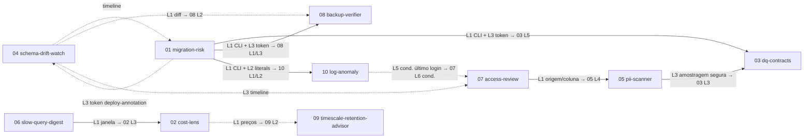

# Planos de desenvolvimento das features do roadmap (db-auditor)

Planos de implementação das 10 specs de [`docs/spec/`](../spec/README.md). Cada plano tem o **mesmo número e nome** da spec. Base lida: `main` em `b1a93cf`. Estes documentos não trazem código de produção.

Cada plano contém:
- lotes já escritos como issue (título, descrição, checklist de aceite), **um PR por lote**, com estimativa;
- arquivos e módulos afetados;
- migrations, com números **provisórios**;
- endpoints e telas, dizendo se a Trinity (UX/UI) é necessária;
- estratégia de testes ligada aos critérios de aceite (CA-xx) da spec;
- gate de cada lote (R2 ou só CI verde);
- riscos e pontos para Q.

## Ordem de implementação

| Ordem | Plano | Feature |
|---|---|---|
| 1 | [06-slow-query-digest.md](06-slow-query-digest.md) | Digest semanal de regressões de consultas |
| 2 | [04-schema-drift-watch.md](04-schema-drift-watch.md) | Linha do tempo e alerta de drift de schema |
| 3 | [01-migration-risk.md](01-migration-risk.md) | Risco de migrations (inaugura o modo CLI e o token por ambiente) |
| 4 | [02-cost-lens.md](02-cost-lens.md) | Custo por tabela, índice e consulta |
| 5 | [07-access-review.md](07-access-review.md) | Revisão periódica de acessos |
| 6 | [05-pii-scanner.md](05-pii-scanner.md) | Mapa de dados pessoais (LGPD) |
| 7 | [03-dq-contracts.md](03-dq-contracts.md) | Contratos de qualidade de dados |
| 8 | [09-timescale-retention-advisor.md](09-timescale-retention-advisor.md) | Simulação de retenção e compressão (TimescaleDB) |
| 9 | [08-backup-verifier.md](08-backup-verifier.md) | Prova de restauração do backup do banco auditado |
| 10 | [10-log-anomaly.md](10-log-anomaly.md) | Anomalias em logs estruturados |

## Grafo de dependências

Seta contínua = dependência forte (bloqueia o lote indicado). Pontilhada = reaproveitamento opcional. O rótulo indica o lote (Lx).

## Resumo

Estimativa em **dias-pessoa (d)** de desenvolvimento, já com testes e docs do lote. O tempo de revisão do R2 e de desenho da Trinity não está incluído. "cond." = lote condicional, fora do v1, que depende de uma decisão de Q.

| Ordem | Spec | Lotes | Estimativa | Lotes com gate R2 | Trinity |
|---|---|---|---|---|---|
| 1 | 06 slow-query-digest | 4 | 13 d | 1 (L3) | sim (L4) |
| 2 | 04 schema-drift-watch | 6 | 23 d | 3 (L1, L4, L5) | sim (L2, L6) |
| 3 | 01 migration-risk | 6 | 25 d | 5 (L1, L3, L4, L5, L6) | sim, escopo pequeno (L3 cartão de tokens, L6 lista) |
| 4 | 02 cost-lens | 6 | 21 d | 0 | sim (L5) |
| 5 | 07 access-review | 5 + 1 cond. | 28 d + 2 d | 4 (L1–L4) + 1 cond. (L6) | sim (L5) |
| 6 | 05 pii-scanner | 6 | 24 d | 4 (L1, L3, L4, L6) | sim (L5) |
| 7 | 03 dq-contracts | 7 | 27 d | 3 (L1, L3, L5) | sim (L6) |
| 8 | 09 timescale-retention-advisor | 5 | 18 d | 1 (L2) | sim (L4) |
| 9 | 08 backup-verifier | 4 | 20 d | 3 (L1, L2, L3) | sim (L4) |
| 10 | 10 log-anomaly | 4 + 1 cond. | 14 d + 6 d | 2 (L2, L4) + 1 cond. (L5) | não no v1 (sim no L5 cond.) |
| | **Total v1** | **53** | **213 d** | **26** | 9 de 10 specs |
| | **Com condicionais** | **55** | **221 d** | **28** | — |

## Migrations provisórias

A última migration hoje é `25_role_attributes_regression_workload.sql`. O número `02` está vago (não existe `02_*.sql`) e **não** deve ser reaproveitado. Os números abaixo valem se os planos forem mergeados **nesta ordem**. Cada PR confirma o próximo número livre no momento do merge.

| Nº | Arquivo | Plano / lote |
|---|---|---|
| 26 | `26_query_digest.sql` | 06 L2 |
| 27 | `27_schema_timeline.sql` | 04 L3 |
| 28 | `28_migration_registry.sql` | 04 L4 |
| 29 | `29_environment_api_token.sql` | 01 L3 |
| 30 | `30_migration_analysis.sql` | 01 L6 |
| 31 | `31_cost_price_table.sql` | 02 L1 |
| 32 | `32_cost_estimate_series.sql` | 02 L4 |
| 33 | `33_grant_origin_column_privilege.sql` | 07 L1 |
| 34 | `34_access_review.sql` | 07 L2 |
| 35 | `35_pii_scanner.sql` | 05 L1 |
| 36 | `36_dq_contracts.sql` | 03 L1 |
| 37 | `37_retention_scenarios.sql` | 09 L2 |
| 38 | `38_chunk_scan_counters.sql` | 09 L3 |
| 39 | `39_target_restore_drill.sql` | 08 L3 |
| 40 | `40_log_anomaly.sql` (cond.) | 10 L5 |
| 41 | `41_account_last_login.sql` (cond.) | 07 L6 |

## Convenções comuns a todos os lotes

**Um PR por lote.** O título do PR é o da issue. O PR cita a spec e os CA cobertos.

**CI verde** quer dizer que todos os jobs de `.github/workflows/ci.yml` passam:
- `Backend (Go)` (gofmt, `sqlc generate` sem diff, vet, staticcheck, golangci-lint, gosec probe, testes com cobertura, escala, orçamento de consultas, relatório sob limite de memória, Trivy);
- `Backend integration (PostgreSQL 14–18)`;
- `Frontend (Bun)` (OpenAPI sem diff, Biome, typecheck, testes, Trivy).

**Gate R2.** Além do CI verde, o lote precisa de revisão e aprovação de R2 antes do merge. Ele se aplica quando o lote:
- (a) muda autenticação, `authMiddleware`/`authorizeRequest` ou credenciais;
- (b) afeta o isolamento entre ambientes (tenant);
- (c) lê linhas reais ou logs, ou exporta e envia dados que podem conter dado pessoal;
- (d) abre nova leitura no banco auditado com entrada configurável;
- (e) mexe na cadeia de suprimentos (release, Action).

**Trinity.** É necessária em todo lote que cria ou muda uma tela. A spec cita áreas "Segurança", "Performance" e "Tabelas temporais", que **não existem como seções de navegação** em `frontend/src/components/layout/Shell.tsx` (grupos Início, Operação, Análise e Sistema). "Segurança" e "Performance" hoje são categorias de `FindingsBrowser` e abas de `InventoryDetailTabs`. A Trinity define a arquitetura de informação das telas novas.

**Definição de pronto de cada lote (quando aplicável):**
- [ ] Rota nova registrada via `mux.HandleFunc` e documentada em `backend/api/openapi.json` (o `internal/api/openapi_test.go` confere), com `frontend/src/types/openapi.ts` regenerado (`bun run gen:openapi`).
- [ ] Migration nova idempotente (`IF NOT EXISTS`), sem `.down.sql`, acrescentada à lista **explícita** do passo "Prepare disposable snapshot store" do job `Backend (Go)` (o job da matriz usa glob), a `backend/migrations/README.md` e à faixa citada no topo de `docs/ops.md`.
- [ ] Regra nova com `rule_id`/`rule_version` imutável, textos e consulta de confirmação em `backend/internal/actions/catalog.go` (`TestEveryCatalogRuleHasFiveFieldsAndASafeQuery`) e seção em `docs/rules.md`.
- [ ] Limiares marcados **valor inicial, calibrar**, configuráveis por ambiente (`rule_policy`), com calibração pelo procedimento BA-15 em `docs/ops.md`.
- [ ] Tela nova com seção "Ajuda por tela" em `docs/guia-do-usuario.md` e `bun run sync:guide` (cópia em `frontend/public/`).
- [ ] Golden de relatório revisado (`go test ./internal/report -run Golden -update`) quando o PDF mudar.
- [ ] Nada de DSN, token, senha, SQL bruto ou valor de linha em log, métrica, evidência ou export (`config.SanitizeError`, `config.SanitizeDSN`).

## Decisões padrão (v1)

Arquitetura definida por Q. São valores padrão do v1 e Maycon pode mudá-los. Cada plano marca a decisão literalmente como **"decisão padrão"** onde ela se aplica.

| Nº | Decisão padrão | Planos |
|---|---|---|
| 1 | A CLI usa um **token novo por ambiente, com escopo mínimo**. `AUDITOR_REPORT_API_TOKEN` não é reutilizado. | 01 (L3), 03 (L5), 08 (L1, L3), 10 (L5 cond.) |
| 2 | Spec 01: o **CI usa só o último snapshot via API**. O **runner nunca recebe a senha do banco**. | 01 (L4, L5); por analogia, 03 (L5) |
| 3 | Spec 02: **uma moeda por ambiente**, com preço configurável. **Bloat só por estimativa**, e o bloat exato fica para depois. | 02; 09 (conversão em moeda) |
| 4 | Spec 03: **amostra padrão continua em 1000 linhas**, configurável **até 100 000 por opt-in**. Spec 05 (PII) tem **flag própria e mais restrita**. | 03 (L3), 05 (L3) |
| 5 | Spec 04: **ler as tabelas de histórico das ferramentas de migration conhecidas** e, **opcionalmente, anotações de deploy**. **Webhook genérico mais formato nativo do Slack.** | 04 (L4, L5) |
| 6 | Spec 06: **só as sugestões de índice existentes, sem HypoPG no v1**, usando os **canais globais atuais**. | 06; 04 (alertas pelos canais globais) |
| 7 | Spec 07: **responsável em texto livre (nome e e-mail)**, **saída CSV no v1 (XLSX depois)**, **último login vindo dos logs quando a spec 10 existir**. | 07 (L2, L4, L6 cond.), 10 (L4) |
| 8 | Spec 08: **restauração só pela CLI, em runner externo, só com `pg_dump`**. **Hash de amostra por tabela é opt-in.** | 08 |
| 9 | Spec 09: **chunks nunca consultados entram no v1**, usando **contadores de varredura como proxy**, rotulados **aproximados**. | 09 (L3) |
| 10 | Spec 10: **logs do PostgreSQL e JSON genérico**, **processados só localmente no início**. | 10 |
| 11 | **Tenant = ambiente** (`audit_environment`, papéis `viewer` < `auditor` < `operator`, concessões em `auditor_user_environment`). | todos |

## Pontos para Q (ambiguidades e conflitos com as decisões)

1. **03 × decisão 4:** o RNF-03 da spec diz "amostra padrão de 10 000". A decisão mantém 1000. O plano segue a decisão.
2. **06 × decisão 6:** a spec pede destinatários por ambiente (RF-07, RNF-04, §4) e o CA-07 fala em "mudar os destinatários". Com os canais globais, o CA-07 vira "mudar a configuração do digest".
3. **07 × decisão 7 (responsável livre):** conflita com o RNF-04 ("responsável deve ter papel auditor"), com "Decidir (auditor responsável)", com o erro 400 "responsável sem acesso" e com "minhas pendências". O plano deixa qualquer auditor do ambiente decidir.
4. **07 × decisão 7 (CSV):** RF-09 e RNF-03 (XLSX) ficam para depois.
5. **07 e 10 × decisões 7 e 10:** se a 10 é só local, o último login não tem como chegar ao auditor. Os lotes 07 L6 e 10 L5 ficaram condicionais. Falta decidir se o v1 inclui um envio mínimo (só role e horário).
6. **10 × decisão 10:** RF-07, CA-06 e RNF-04 saem do v1.
7. **01 × decisão 2:** o RF-04(b) e o CA-06 exigem o modo de conexão direta. O plano mantém o modo (b) só para uso local, fora da Action.
8. **01 CA-08:** cita PG 14 × 16. Dentro da matriz, a diferença de lock mais clara é a do PG 18 (`NOT NULL ... NOT VALID`). Confirmar a operação de referência.
9. **04 × decisão 5:** a redação inverte a prioridade do RF-05 (anotação = (a)). Além disso, golang-migrate, Alembic e Rails não gravam o carimbo de aplicação, então a correlação para essas ferramentas é só por "a versão mudou entre as coletas".
10. **04 × decisões 5 e 6:** o formato Slack é global (`AUDITOR_ALERT_WEBHOOK_FORMAT`) e vale também para os alertas já existentes.
11. **08 × decisões 2 e 8:** o hash de amostra opt-in exige DSN só leitura da produção no runner. A decisão 2 vale para a 08? Com (c) desligado, o CA-01 só passa com o opt-in, e "(c) desabilitada" foi tratada como código 0, não 3. O RF-03 (recusar destino igual a um DSN configurado) depende de fingerprints de host fornecidos pela API.
12. **02 × decisão 3:** pode trocar a moeda de um ambiente depois da primeira versão? O plano trava. A P-03 (provedores extras) segue aberta.
13. **03 P-02:** onde fica o contrato canônico (UI × Git) não foi decidido. O plano trata o auditor como canônico e o YAML via CLI como execução *ad hoc*. A integração com regressão AN-11 usa a dedup de achados, porque `regression_alert` não tem categoria `quality`.
14. **05:** o CNPJ alfanumérico da Receita Federal (a partir de julho de 2026) muda o DV. Suportar no v1? Quem edita o dicionário (o plano diz operator)?
15. **09 CA-04:** pede achado "ao salvar o cenário". O plano cria o achado no salvamento, vinculado à última coleta completa.
16. **UI das specs:** "Segurança", "Performance" e "Tabelas temporais" não são seções de navegação hoje. Precisa de decisão de arquitetura de informação com a Trinity.
17. **Imprecisões das specs em relação ao código:**
    - `internal/fingerprint.NormalizeSQL` **não** remove literais. A remoção mora em `collectors/postgres/stats_workload.go` (`NormalizeQuery`). O plano 01 L2 extrai para `internal/fingerprint/literals.go`.
    - O binário é compilado com `CGO_ENABLED=0`, então o parser de DDL precisa ser Go puro.
    - Não há ADRs no repositório (`docs/` não tem diretório nem arquivos de ADR). As decisões de Q estão registradas só aqui e nos planos. Sugestão: criar `docs/adr/` quando as decisões forem confirmadas.
