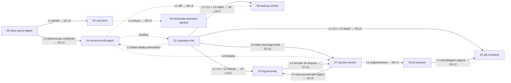

# Planos de desenvolvimento das features do roadmap (db-auditor)

Planos de implementação das 10 specs de [`docs/spec/`](../spec/README.md). Cada plano tem o **mesmo número e nome** da spec. Base lida: `main` em `b1a93cf`. Estes documentos não trazem código de produção.

**Decisões de arquitetura:** [ADR-0001](../adr/0001-decisoes-v1-features.md) (Aceita, 2026-10-18). Os planos citam as decisões como **ADR-0001 Dn**. Specs, planos e ADR estão alinhados. Quando houver divergência, vale a ADR.

Cada plano contém:
- lotes já escritos como issue (título, descrição, checklist de aceite), **um PR por lote**, com estimativa;
- arquivos e módulos afetados;
- migrations, com números **provisórios**;
- endpoints e telas, dizendo se a Trinity (UX/UI) é necessária;
- estratégia de testes ligada aos critérios de aceite (CA-xx) da spec;
- gate de cada lote (R2 ou só CI verde);
- riscos e pontos para Q, agora resolvidos com referência à ADR.

## Ordem de implementação

| Ordem | Plano | Feature |
|---|---|---|
| 1 | [06-slow-query-digest.md](06-slow-query-digest.md) | Digest semanal de regressões de consultas (cria os destinos de notificação por ambiente) |
| 2 | [04-schema-drift-watch.md](04-schema-drift-watch.md) | Linha do tempo e alerta de drift de schema |
| 3 | [01-migration-risk.md](01-migration-risk.md) | Risco de migrations (inaugura o modo CLI e o token por ambiente) |
| 4 | [02-cost-lens.md](02-cost-lens.md) | Custo por tabela, índice e consulta |
| 5 | [07-access-review.md](07-access-review.md) | Revisão periódica de acessos (lotes 1–5; o lote 6 vem no fim, ver abaixo) |
| 6 | [05-pii-scanner.md](05-pii-scanner.md) | Mapa de dados pessoais (LGPD) |
| 7 | [03-dq-contracts.md](03-dq-contracts.md) | Contratos de qualidade de dados |
| 8 | [09-timescale-retention-advisor.md](09-timescale-retention-advisor.md) | Simulação de retenção e compressão (TimescaleDB) |
| 9 | [08-backup-verifier.md](08-backup-verifier.md) | Prova de restauração do backup do banco auditado |
| 10 | [10-log-anomaly.md](10-log-anomaly.md) | Anomalias em logs estruturados |

O último login (ADR-0001 D10) fecha a sequência:
1. **10 L1–L4**: CLI local e arquivo de último login;
2. **07 L6**: rota, tabela e exibição no auditor;
3. **10 L5**: envio pela CLI.

O plano 07 L6 só é implementado depois do 10 L4, porque o formato do arquivo é definido lá.

## Grafo de dependências

Seta contínua = dependência forte (bloqueia o lote indicado). Pontilhada = reaproveitamento opcional. O rótulo indica o lote (Lx).

## Resumo

Estimativa em **dias-pessoa (d)** de desenvolvimento, já com testes e docs do lote. O tempo de revisão do R2 e de desenho da Trinity não está incluído. Não há mais lotes condicionais: o 07 L6 e o 10 L5 entraram no v1 (ADR-0001 D10).

| Ordem | Spec | Lotes | Estimativa | Lotes com gate R2 | Trinity | Mudança desde `a2ce03a` |
|---|---|---|---|---|---|---|
| 1 | 06 slow-query-digest | 4 | 16 d | 1 (L3) | sim (L4) | +3 d: destinatários por ambiente com fallback global (D6, D15) |
| 2 | 04 schema-drift-watch | 6 | 23 d | 3 (L1, L4, L5) | sim (L2, L6) | Slack por webhook (D15); L5 depende de 06 L3 |
| 3 | 01 migration-risk | 6 | 25 d | 5 (L1, L3, L4, L5, L6) | sim, escopo pequeno (L3, L6) | — |
| 4 | 02 cost-lens | 6 | 21 d | 0 | sim (L5) | — |
| 5 | 07 access-review | 6 | 32 d | 5 (L1–L4, L6) | sim (L5) | +4 d sobre o v1 anterior (28 d): +1 d no L3 (autorização por responsável, D7) e o L6 entra no v1 com 3 d (antes 2 d condicional; agora recebe o envio, D10) |
| 6 | 05 pii-scanner | 6 | 25 d | 4 (L1, L3, L4, L6) | sim (L5) | +1 d: CNPJ alfanumérico (D14) |
| 7 | 03 dq-contracts | 7 | 27 d | 3 (L1, L3, L5) | sim (L6) | amostra padrão 10 000 (D4) |
| 8 | 09 timescale-retention-advisor | 5 | 18 d | 1 (L2) | sim (L4) | — |
| 9 | 08 backup-verifier | 4 | 20 d | 3 (L1, L2, L3) | sim (L4) | hash só com DSN do operator; CA-09 (D8) |
| 10 | 10 log-anomaly | 5 | 16 d | 3 (L2, L4, L5) | não | +2 d sobre o v1 anterior (14 d): o L5 entra no v1 só com o envio do último login, 2 d em vez dos 6 d condicionais (D10) |
| | **Total** | **55** | **223 d** | **28** | 9 de 10 specs | antes: 53 lotes + 2 cond., 213 d + 8 d, 26 + 2 R2 |

## Migrations provisórias

A última migration hoje é `25_role_attributes_regression_workload.sql`. O número `02` está vago (não existe `02_*.sql`) e **não** deve ser reaproveitado. Os números abaixo valem se os planos forem mergeados **nesta ordem**. Cada PR confirma o próximo número livre no momento do merge.

| Nº | Arquivo | Plano / lote |
|---|---|---|
| 26 | `26_query_digest.sql` (inclui `notification_destination`) | 06 L2 |
| 27 | `27_schema_timeline.sql` | 04 L3 |
| 28 | `28_migration_registry.sql` | 04 L4 |
| 29 | `29_environment_api_token.sql` | 01 L3 |
| 30 | `30_migration_analysis.sql` | 01 L6 |
| 31 | `31_cost_price_table.sql` | 02 L1 |
| 32 | `32_cost_estimate_series.sql` | 02 L4 |
| 33 | `33_grant_origin_column_privilege.sql` | 07 L1 |
| 34 | `34_access_review.sql` | 07 L2 |
| 35 | `35_pii_scanner.sql` | 05 L1 |
| 36 | `36_dq_contracts.sql` | 03 L1 |
| 37 | `37_retention_scenarios.sql` | 09 L2 |
| 38 | `38_chunk_scan_counters.sql` | 09 L3 |
| 39 | `39_target_restore_drill.sql` | 08 L3 |
| 40 | `40_account_last_login.sql` | 07 L6 (depois de 10 L4) |

O plano 10 não tem migration. As tabelas de anomalia de log ficam fora do v1 (ADR-0001 D10).

## Convenções comuns a todos os lotes

**Um PR por lote.** O título do PR é o da issue. O PR cita a spec, os CA cobertos e as decisões da ADR-0001 aplicadas.

**CI verde** quer dizer que todos os jobs de `.github/workflows/ci.yml` passam:
- `Backend (Go)` (gofmt, `sqlc generate` sem diff, vet, staticcheck, golangci-lint, gosec probe, testes com cobertura, escala, orçamento de consultas, relatório sob limite de memória, Trivy);
- `Backend integration (PostgreSQL 14–18)`;
- `Frontend (Bun)` (OpenAPI sem diff, Biome, typecheck, testes, Trivy).

**Gate R2.** Além do CI verde, o lote precisa de revisão e aprovação de R2 antes do merge. Ele se aplica quando o lote:
- (a) muda autenticação, `authMiddleware`/`authorizeRequest`, credenciais ou escopos de token;
- (b) afeta o isolamento entre ambientes (tenant);
- (c) lê linhas reais ou logs, ou exporta e envia dados que podem conter dado pessoal (incluindo destinatários e URLs de webhook);
- (d) abre nova leitura no banco auditado com entrada configurável;
- (e) mexe na cadeia de suprimentos (release, Action).

**Trinity.** É necessária em todo lote que cria ou muda uma tela. A spec cita áreas "Segurança", "Performance" e "Tabelas temporais", que **não existem como seções de navegação** em `frontend/src/components/layout/Shell.tsx` (grupos Início, Operação, Análise e Sistema). **A posição das telas na navegação fica adiada para os lotes de tela**, quando Q chamará a Trinity (ADR-0001, Pendente). Os planos não decidem o lugar.

**Definição de pronto de cada lote (quando aplicável):**
- [ ] Rota nova registrada via `mux.HandleFunc` e documentada em `backend/api/openapi.json` (o `internal/api/openapi_test.go` confere), com `frontend/src/types/openapi.ts` regenerado (`bun run gen:openapi`).
- [ ] Migration nova idempotente (`IF NOT EXISTS`), sem `.down.sql`, acrescentada à lista **explícita** do passo "Prepare disposable snapshot store" do job `Backend (Go)` (o job da matriz usa glob), a `backend/migrations/README.md` e à faixa citada no topo de `docs/ops.md`.
- [ ] Regra nova com `rule_id`/`rule_version` imutável, textos e consulta de confirmação em `backend/internal/actions/catalog.go` (`TestEveryCatalogRuleHasFiveFieldsAndASafeQuery`) e seção em `docs/rules.md`.
- [ ] Limiares marcados **valor inicial, calibrar**, configuráveis por ambiente (`rule_policy`), com calibração pelo procedimento BA-15 em `docs/ops.md`.
- [ ] Tela nova com seção "Ajuda por tela" em `docs/guia-do-usuario.md` e `bun run sync:guide` (cópia em `frontend/public/`).
- [ ] Golden de relatório revisado (`go test ./internal/report -run Golden -update`) quando o PDF mudar.
- [ ] Nada de DSN, token, senha, URL de webhook, SQL bruto ou valor de linha em log, métrica, evidência ou export (`config.SanitizeError`, `config.SanitizeDSN`).

## Decisões (ADR-0001)

Resumo. O texto completo, com contexto e consequências, está em [ADR-0001](../adr/0001-decisoes-v1-features.md).

| Nº | Decisão | Planos |
|---|---|---|
| D1 | Token novo por ambiente, escopo mínimo e validade obrigatória. `AUDITOR_REPORT_API_TOKEN` não é reutilizado. Escopos: `snapshot-context:read`, `migration-analysis:write`, `deploy-annotation:write`, `quality-contract:run`, `restore-evidence:write`, `last-login:write` | 01 (L3), 03 (L5), 07 (L6), 08 (L1, L3), 10 (L5) |
| D2 | Spec 01: CI só com snapshot via API. O runner de CI nunca recebe DSN. O modo (b) é só para uso local (confirmada) | 01 (L4, L5); 03 (L5) por analogia |
| D3 | Spec 02: uma moeda por ambiente, travada depois da primeira versão. Bloat só estimado. Modelos RDS, Cloud SQL, self-hosted | 02; 09 |
| D4 | **(emendada)** Spec 03: amostra padrão **10 000**, opt-in até 100 000; `quality-scans` mantém 1000. Spec 05: flag própria mais restrita, com habilitação por ambiente e amostra de 1000 | 03 (L3), 05 (L3) |
| D5 | Spec 04: anotação de implantação ou registro de migrations (6 ferramentas), qualquer um correlaciona. Sem carimbo, a correlação é por mudança de versão. Par por `is_production` + `object_mapping` | 04 (L3, L4) |
| D6 | **(emendada)** Spec 06: sem HypoPG. **Destinatários por ambiente**, com fallback nos canais globais. Alertas existentes não mudam | 06 (L3, L4); 04 (L5) |
| D7 | **(emendada)** Spec 07: **responsável = conta do auditor** (auditor ou acima), com contato livre opcional. Decide o responsável, ou o operator nas linhas sem responsável. CSV no v1, XLSX depois. Último login dos logs | 07 (L2–L6) |
| D8 | **(emendada)** Spec 08: só CLI em runner externo, só `pg_dump`. Hash opt-in **só com DSN só leitura fornecido pelo operator**. CA-01 por contagens, hash no CA-09. "(c) desabilitada" não é parcial. Fingerprints de host da API | 08 (L1–L3) |
| D9 | Spec 09: chunks sem consulta por proxy aproximado. Achado do cenário criado no salvamento | 09 (L2, L3) |
| D10 | **(emendada)** Spec 10: logs PG + JSON genérico, processamento local. **Só o agregado role + último horário sobe à API** | 10 (L4, L5), 07 (L6) |
| D11 | Tenant = ambiente | todos |
| D12 | Spec 01: CA-08 com MR-04 (`NOT NULL ... NOT VALID` no PG 18). SARIF fora do v1 | 01 (L2) |
| D13 | Spec 03: contrato canônico no auditor. YAML da CLI é execução *ad hoc*. Dedup e notificação de achados, sem categoria `quality` | 03 (L1, L3, L5) |
| D14 | Spec 05: CNPJ numérico e alfanumérico. Dicionário editado pelo operator. JSONB e texto livre fora do v1 | 05 (L1, L2) |
| D15 | Formato de webhook (`generic`/`slack`) **por webhook**. Webhook global e alertas existentes sem mudança | 06 (L2, L3), 04 (L5) |
| D16 | Literais extraídos para `internal/fingerprint`. Parser em Go puro. ADRs em `docs/adr/` | 01 (L2), 10 (L2) |

## Pontos para Q

Todos os conflitos levantados em `a2ce03a` foram **resolvidos** pela ADR-0001:

| # | Ponto | Resolução |
|---|---|---|
| 1 | 03: amostra padrão 10 000 (spec) × 1000 (decisão) | D4 (emendada): 10 000, opt-in até 100 000 |
| 2 | 06: destinatários por ambiente × canais globais; CA-07 | D6 (emendada): por ambiente com fallback global. O CA-07 volta ao texto original |
| 3 | 07: responsável livre × RNF-04, 400, "minhas pendências" | D7 (emendada): conta do auditor, com contato opcional |
| 4 | 07: XLSX | D7: CSV no v1, XLSX depois (spec ajustada) |
| 5 | 07/10: sem caminho para o último login | D10 (emendada): só o agregado role + horário sobe. 07 L6 e 10 L5 no v1 |
| 6 | 10: RF-07, CA-06, RNF-04 fora do v1 | D10: RF-07 fora do v1. CA-06 e RNF-04 valem para o envio do último login (spec ajustada) |
| 7 | 01: modo (b) × D2 | D2 (confirmada): só uso local |
| 8 | 01: referência do CA-08; SARIF | D12 |
| 9 | 04: ordem das fontes e ferramentas sem carimbo; entidade de par | D5 |
| 10 | 04: formato Slack global | D15: por webhook, alertas existentes sem mudança |
| 11 | 08: DSN no runner, CA-01, código de "(c) desabilitada", fingerprints | D8 (emendada) e CA-09 na spec |
| 12 | 02: troca de moeda; provedores | D3 |
| 13 | 03: contrato canônico; categoria `quality` | D13 |
| 14 | 05: CNPJ alfanumérico; dicionário; habilitação por ambiente | D14, D4 |
| 15 | 09: achado no salvamento do cenário | D9 |
| 16 | Telas em "Segurança", "Performance", "Tabelas temporais" | **Adiado, sem decisão:** Q chamará a Trinity nos lotes de tela |
| 17 | Imprecisões das specs (literais em `internal/fingerprint`, CGO, ADRs ausentes) | D16 (specs corrigidas; `docs/adr/` criado) |

**Ainda em aberto (não são decisões de Q):**
- a posição das telas na navegação (item 16), com a Trinity em cada lote de UI;
- a guarda em repouso da URL de webhook por ambiente, que R2 decide no gate do lote 3 do plano 06.
