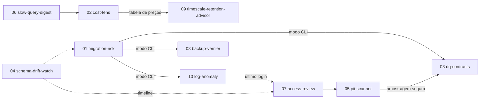

# Specs das features do roadmap (db-auditor)

Autor: M (Product Owner). Fonte: `ideias-projetos.md` (10 ideias). Decisão de arquitetura (Q): as 10 ideias viram **features do db-auditor**, não projetos separados. Base lida: `main` em `d12c362`.

**Decisões de arquitetura do v1:** [ADR-0001](../adr/0001-decisoes-v1-features.md) (Aceita, 2026-10-18). As perguntas em aberto (P-xx) de cada spec estão resolvidas lá. Quando uma spec e a ADR divergirem, vale a ADR.

## Índice

| # | Spec | Feature | Onde roda |
|---|---|---|---|
| 01 | [01-migration-risk.md](01-migration-risk.md) | Risco de migrations com contexto do banco real | CLI do mesmo binário + integração GitHub Action |
| 02 | [02-cost-lens.md](02-cost-lens.md) | Custo por tabela, índice e consulta | API/UI/PDF |
| 03 | [03-dq-contracts.md](03-dq-contracts.md) | Contratos de qualidade de dados | API/UI + CLI (gate de CI) |
| 04 | [04-schema-drift-watch.md](04-schema-drift-watch.md) | Linha do tempo e alerta de drift de schema | API/UI/webhook |
| 05 | [05-pii-scanner.md](05-pii-scanner.md) | Mapa de dados pessoais (LGPD) | API/UI/PDF/CSV |
| 06 | [06-slow-query-digest.md](06-slow-query-digest.md) | Digest semanal de regressões de consultas | API/UI/e-mail/webhook |
| 07 | [07-access-review.md](07-access-review.md) | Revisão periódica de acessos | API/UI/CSV (XLSX depois, ADR-0001 D7) |
| 08 | [08-backup-verifier.md](08-backup-verifier.md) | Prova de restauração do backup do banco auditado | CLI do mesmo binário (container efêmero) + API |
| 09 | [09-timescale-retention-advisor.md](09-timescale-retention-advisor.md) | Simulação de retenção e compressão no TimescaleDB | API/UI/PDF |
| 10 | [10-log-anomaly.md](10-log-anomaly.md) | Anomalias em logs estruturados | CLI do mesmo binário (+ envio do agregado de último login à API, ADR-0001 D10) |

## Ordem sugerida de implementação

| Ordem | Spec | Justificativa |
|---|---|---|
| 1 | 06 slow-query-digest | Menor esforço: `workload_snapshot`, controle de `stats_reset` e categoria `workload` de regressão já existem. Falta só delta por janela, digest e entrega. |
| 2 | 04 schema-drift-watch | Fecha uma lacuna real: a tela **Desvio de schema** usa dados de demonstração fixos no frontend. Os snapshots estruturais já existem. A linha do tempo também serve de base para 01 e 07. |
| 3 | 01 migration-risk | Maior impacto contra incidentes. Inaugura o **modo CLI** do binário, que 03, 08 e 10 reaproveitam. Usa tamanhos e taxas de escrita já coletados. |
| 4 | 02 cost-lens | Fala a língua da gestão. Reaproveita armazenamento, `index.unused`, workload e o esquema de impacto (AN-03). Usa os deltas de 06 para custo de consulta. |
| 5 | 07 access-review | Estende `grant_snapshot`, `account_role_snapshot` e `security.powerful_role`. A matriz de privilégio efetivo é pré-requisito do 05. |
| 6 | 05 pii-scanner | Diferencial LGPD. Precisa da matriz de quem lê (07) e da infraestrutura de amostragem do diagnóstico de qualidade. |
| 7 | 03 dq-contracts | Estende o diagnóstico de qualidade existente. Usa o modo CLI (01) e a amostragem endurecida em 05. |
| 8 | 09 timescale-retention-advisor | Nicho, mas é extensão direta dos coletores Timescale. Usa a tabela de preços do 02. |
| 9 | 08 backup-verifier | Alto valor e alto risco operacional: exige runtime de container fora da API. Reaproveita o procedimento de #106. |
| 10 | 10 log-anomaly | Menos alinhado ao foco em banco. Fica por último e com escopo restrito. |

## Dependências entre specs

Seta contínua = dependência forte (bloqueia). Pontilhada = reaproveitamento opcional.

## Convenções comuns (valem para todas as specs)

- **Só leitura.** Toda conexão ao banco auditado usa a conexão só leitura existente (`collectors/postgres/readonly_connection`), que recusa conta com escrita, aplica timeouts de statement e lock e respeita `AUDITOR_TARGET_ALLOWED_HOSTS` e TLS `verify-full`. Nenhuma feature executa DDL, DML, revogação ou manutenção. Recomendação é texto para humano.
- **Achados.** Novos sinais entram no catálogo versionado de regras (`rule_catalog`, imutável por `rule_id`/`rule_version`), com override por ambiente e schema (`rule_policy`), evidência, confiança, `impact_estimate` (AN-03), prioridade `priority-v1` e deduplicação existentes. Severidades: crítica, alta, média, baixa, informativa.
- **Histórico.** Resultados ficam vinculados a `audit_run` ou a um novo registro de execução da feature, com versão do coletor/regra e cobertura. Coleta parcial nunca vira "resolvido" nem dispara regressão (AN-11).
- **Multi-tenant.** No repositório não existe uma entidade "tenant" separada. A unidade de isolamento é o **ambiente** (`audit_environment`), com papéis `viewer` < `auditor` < `operator` e concessões por ambiente (`auditor_user_environment`). Hoje: GET exige viewer, escrita exige operator por padrão (algumas exigem auditor) e download exige auditor. O operator vê todos os ambientes. Toda feature segue esse modelo.
- **LGPD.** Persistir e exibir só metadados, contagens, proporções, hashes e fingerprints. Nunca valores de linha, texto SQL com literais ou linhas de log brutas. A redação do PDF (sem redação / identificadores / estrita) vale para as novas seções.
- **Modo CLI (novo, comum a 01, 03, 08, 10).** O mesmo binário da API (`backend/cmd/auditor`) ganha subcomandos. Hoje ele só tem `recover-operator`. Saídas em Markdown e JSON. Segredos só por variável de ambiente ou arquivo, nunca em argumento. O envio de resultado à API usa o token por ambiente com escopo mínimo (ADR-0001 D1). O runner de CI nunca recebe DSN do banco auditado (ADR-0001 D2), com a única exceção do opt-in da 08 (ADR-0001 D8).
- **Códigos de saída da CLI (novo, comum).** 0 = nada acima do limiar. 1 = achado igual ou acima do limiar de bloqueio configurado. 2 = erro de uso ou configuração. 3 = dados insuficientes ou execução parcial (nunca conta como sucesso). 4 = recusa de segurança (conta com escrita, destino não isolado, host fora da allowlist).
- **Limiar "valor inicial, calibrar".** É um palpite de produto, configurável por ambiente. A calibração segue o padrão do BA-15 (#104): coletas reais e taxa de falso positivo registrada.
